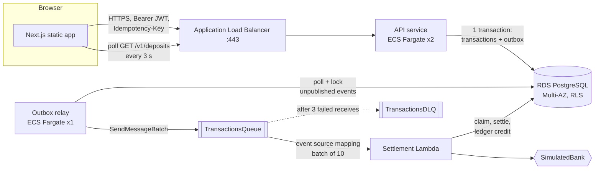
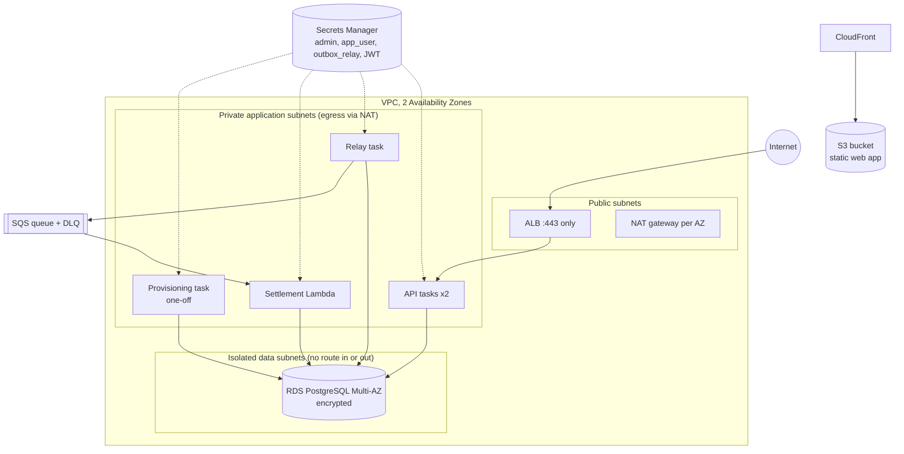
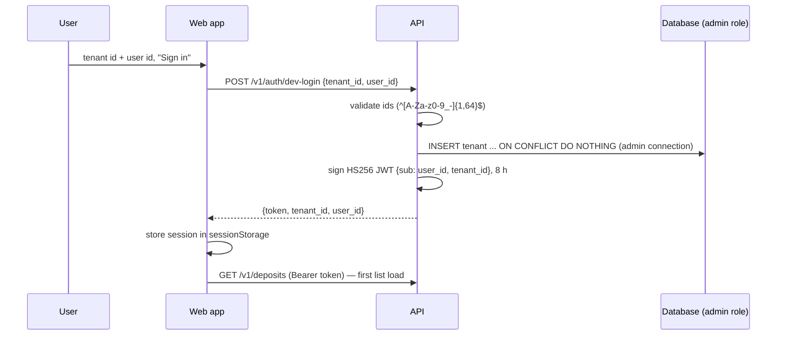

# ACEX Credit — fund deposit platform (MVP)

A multi-tenant fintech backend and web app for **funding an account by bank deposit**. A user signs in, requests a
deposit, and watches it move from `PENDING` to `SETTLED` (or `FAILED`) in a live transaction list. Between the request
and the final state the deposit crosses an HTTP API, a PostgreSQL database, an outbox relay, a queue, and a serverless
settlement worker.

> **MVP scope.** The bank is **simulated** (`SimulatedBank`, no access to the real platform yet), login is a
> **development-only simulated route**, and everything has been deployed to the **floci** AWS emulator, never to real AWS.
> See [Known gaps](#known-gaps).

- [1. Repository layout](#1-repository-layout)
- [2. Architecture](#2-architecture)
- [3. Data model and tenant isolation](#3-data-model-and-tenant-isolation)
- [4. The contract](#4-the-contract)
- [5. Login flow](#5-login-flow)
- [6. Life of a deposit](#6-life-of-a-deposit)
- [7. Delivery guarantees](#7-delivery-guarantees)
- [8. The web app](#8-the-web-app)
- [9. Infrastructure as code](#9-infrastructure-as-code)
- [10. Running it](#10-running-it)
- [11. Tests](#11-tests)
- [12. Known gaps](#12-known-gaps)

---

## 1. Repository layout

```
apps/
  api/      Fastify HTTP API + outbox relay + SQS settlement handler (Node 22, TypeScript, Kysely, pg)
  web/      Next.js 16 app (statically exported), atomic design components
  infra/    AWS CDK app: network, database, queues, Lambda, ECS, ALB, web hosting
packages/
  shared/   The contract: request/response/event types, validators, error codes (used by api AND web)
specs/      Product, system, contract and IaC specifications the code implements
scripts/    floci helpers: deploy, destroy, smoke test, ACM certificate, deposit.sh
docs/       LOCAL-DEV.md (step by step local and floci setup)
odd/tasks/  Feature tracking documents (specs quoted verbatim, tasks, commits)
```

It is an **Nx + pnpm** monorepo (`pnpm test`, `pnpm typecheck` run every project). `@acex/shared` is consumed as TypeScript
source by the API, the web app and the CDK bundle, so the wire format exists in exactly one place.

## 2. Architecture

### 2.1 Logical view



Why it is shaped this way:

| Concern | Decision | Reason |
| --- | --- | --- |
| Fast, safe intake | The API only validates and **records** the deposit, then answers `202 PENDING` | The slow, unreliable part (the bank) never blocks the user's request |
| Never lose an event | **Transactional outbox**: the event is written in the *same* DB transaction as the deposit | Avoids the dual-write problem between the database and the queue |
| Move events out | A separate **relay** process drains the outbox into SQS | Keeps the API stateless and lets a queue outage not fail deposits |
| Absorb bank failures | SQS + **Lambda** + DLQ after 3 receives | Retries are free; poison messages are parked for manual audit instead of blocking the pipeline |
| Tenant isolation | PostgreSQL **row-level security** keyed on a per-transaction setting | A bug in a query cannot leak another tenant's rows |
| Money safety | Integer cents, append-only **ledger**, status-guarded updates | No float rounding, no double credit, history cannot be rewritten |

### 2.2 AWS topology (what the CDK declares)



Security groups form a chain: **internet → ALB (443) → API (3000) → database (5432)**. The database security group has no
egress and accepts connections only from the API, relay, Lambda and provisioning task groups. The API task role has *no*
SQS permission (only the relay publishes); the relay's task role may `sqs:SendMessage` to the main queue only. No IAM policy
uses wildcard actions (asserted by a test).

## 3. Data model and tenant isolation

Tables (migrations in `apps/api/src/db/migrations`):

| Table | Purpose |
| --- | --- |
| `tenants` | One row per tenant |
| `accounts` | One per `(tenant, user, currency)`; holds `balance_cents` |
| `transactions` | The deposit **state machine**: `PENDING → PROCESSING → SETTLED \| FAILED`; unique `(tenant_id, idempotency_key)` |
| `outbox` | Events waiting to be published (`published_at IS NULL`) |
| `ledger_entries` | **Append-only** record of credits; one row per transaction (`UNIQUE transaction_id`); `UPDATE`/`DELETE`/`TRUNCATE` blocked by triggers even for superusers |

**Row-level security.** Every table has RLS enabled *and forced*, with the policy
`tenant_id = current_setting('app.current_tenant_id', true)`. Application code never filters by tenant: it runs every
database interaction through `withTenant(db, tenantId, fn)`, which opens a transaction and executes
`select set_config('app.current_tenant_id', $1, true)` (transaction-local) before `fn`. The same call also sets
`application_name = corr:<correlation-id>` so Postgres logs can be tied to a request.

**Three database roles**, each with the least privilege it needs (created by the migrations, passwords set by provisioning):

| Role | Used by | Can do |
| --- | --- | --- |
| `root` (admin) | migrations and provisioning only | Everything; bypasses RLS |
| `app_user` | API and settlement Lambda | `SELECT/INSERT/UPDATE` on accounts, transactions, outbox; `SELECT/INSERT` on ledger; **subject to RLS** |
| `outbox_relay` | relay | `SELECT` on `outbox` of **all tenants** (dedicated permissive policy) and `UPDATE (published_at)` only |

## 4. The contract

`packages/shared` is the single source of truth (it implements `specs/03-CONTRACT-SPEC.md`):

- **Headers:** `Authorization: Bearer <jwt>` (tenant and user come from the verified token), `Idempotency-Key`
  (1–64 chars of `A-Za-z0-9_-`), `X-Correlation-Id` (optional, generated if absent), `X-Tenant-Id` (optional; if present it
  must match the token or the API answers `403 TENANT_MISMATCH`).
- **Request** `POST /v1/deposits`: `{ amount_cents, currency, source_account: { holder_name, iban } }`. `parseDepositRequest`
  enforces a positive safe integer up to `MAX_DEPOSIT_CENTS` ($1,000,000), a 3-letter upper-case currency, a valid IBAN
  (ISO 13616 mod-97, normalised) and a 1–140 character holder name.
- **Success response:** `{ transaction_id, status, created, correlation_id }` — `202` with `created: true` the first time,
  `200` with `created: false` and the *current* status on an idempotent replay.
- **Error response:** `{ code, message, correlation_id }` with a closed set of codes (`UNAUTHORIZED`, `TENANT_MISMATCH`,
  `INVALID_IDEMPOTENCY_KEY`, `IDEMPOTENCY_KEY_CONFLICT`, `INVALID_BODY`, `INVALID_AMOUNT`, `AMOUNT_EXCEEDS_LIMIT`,
  `INVALID_CURRENCY`, `INVALID_IBAN`, `INVALID_ACCOUNT_HOLDER`, `INTERNAL_ERROR`).
- **Queue event** `DepositRequested` (envelope): `{ event_id, event_type, schema_version: 1, occurred_at, tenant_id, correlation_id,
  data: { transaction_id, account_id, amount_cents, currency, source_account } }`. `parseDepositRequestedEvent` rejects
  unsupported schema versions, so the format can evolve without silently breaking the consumer.
- **Read model** `GET /v1/deposits`: `{ items: [{ transaction_id, amount_cents, currency, status, created_at }] }`, newest
  first, limited to the caller's own deposits (max 50).

The same `parseDepositRequest` runs in the browser (instant field errors) and in the API (authoritative check).

## 5. Login flow

There is no identity provider yet. The MVP has a **simulated login route**, mounted only when `DEV_LOGIN_ENABLED=true`
(never in the deployed stack):



Details worth knowing:

- The tenant row is created through a **separate admin connection**: `app_user` is deliberately *not* allowed to insert
  tenants, so enabling the dev login is an explicit, visible act (`ADMIN_DATABASE_URL`).
- Every protected route calls `verifyBearer`, which checks the HS256 signature and requires string `sub` and
  `tenant_id` claims. Those two values — never request headers — decide whose rows are visible.
- The web app keeps `{token, tenant_id, user_id}` in `sessionStorage` (cleared on sign-out or tab close). If any API call
  returns `UNAUTHORIZED` (expired or invalid token) the app drops the session and shows the login form again.
- CORS: the API answers preflight and adds `Access-Control-Allow-Origin` only for the single configured `CORS_ORIGIN`.

## 6. Life of a deposit

The whole journey, from the click to the transaction appearing as **SETTLED** in the list:

```mermaid
sequenceDiagram
  autonumber
  participant W as Web app
  participant A as API (ECS)
  participant DB as PostgreSQL
  participant R as Relay (ECS)
  participant Q as SQS queue
  participant L as Settlement Lambda
  participant B as SimulatedBank

  W->>W: validate form, amount "50.00" -> 5000 cents, pick Idempotency-Key
  W->>A: POST /v1/deposits (Bearer, Idempotency-Key, X-Correlation-Id)
  A->>A: verify JWT, check tenant header, key format, body
  A->>DB: BEGIN; set tenant context
  A->>DB: upsert account; INSERT transaction (PENDING) ON CONFLICT (tenant, key) DO NOTHING
  A->>DB: INSERT outbox row (DepositRequested envelope)
  A->>DB: COMMIT
  A-->>W: 202 {transaction_id, status: PENDING, created: true}
  W->>A: GET /v1/deposits (refresh now, then every 3 s)
  loop relay loop (sleeps 500 ms when idle)
    R->>DB: BEGIN; SELECT unpublished outbox FOR UPDATE SKIP LOCKED LIMIT 10
    R->>Q: SendMessageBatch (body = envelope; attributes: correlation_id, tenant_id, event_type)
    R->>DB: UPDATE outbox SET published_at; COMMIT
  end
  Q->>L: invoke with a batch (ReportBatchItemFailures)
  L->>DB: tx 1: PENDING -> PROCESSING (guarded UPDATE)
  L->>B: requestTransfer(reference = transaction_id)
  B-->>L: CLEARED
  L->>DB: tx 2: PROCESSING -> SETTLED (guarded UPDATE) + INSERT ledger CREDIT + balance += amount
  W->>A: GET /v1/deposits (next poll)
  A->>DB: SELECT own transactions (RLS)
  A-->>W: item status SETTLED
```

Step by step:

1. **Form (browser).** `DepositForm` converts the typed amount (`"1,250.50"`) to integer cents with `parseAmountToCents`
   (at most two decimals), then runs the shared `parseDepositRequest`. Invalid input maps to per-field errors and nothing
   is sent. The IBAN is normalised (spaces removed, upper-cased).
2. **Idempotency key.** `createIntentKeys` generates `idk_<uuid>` and **reuses it** if the user retries the identical
   request after a failure or timeout; a changed request, or one the API accepted, gets a fresh key.
3. **Intake (API).** The handler verifies the token, the optional `X-Tenant-Id`, the key format and the body, in that order,
   returning the contract error code for the first problem.
4. **One database transaction** (`createDeposit`, under the tenant's RLS context): upsert the account; insert the
   `transactions` row as `PENDING` with `ON CONFLICT (tenant_id, idempotency_key) DO NOTHING`; if it was inserted, also insert
   the `outbox` row holding the full `DepositRequested` event. Either both rows exist or neither does. If the insert
   conflicted, the existing row is returned instead: same fingerprint (`sha256` of user, amount, currency, holder, IBAN) →
   `200` replay with the current status; different fingerprint → `409 IDEMPOTENCY_KEY_CONFLICT`.
5. **Response.** `202 {PENDING}`. The form clears and shows the transaction id; the page triggers an immediate list refresh.
6. **Relay.** A long-running process (its own ECS service, DB role `outbox_relay`) selects up to 10 unpublished rows with
   `FOR UPDATE SKIP LOCKED`, sends them in one `SendMessageBatch` (the correlation and tenant ids travel as message
   attributes too), and marks the successfully sent ones `published_at = now()` in the same transaction. Several relays
   can run side by side without taking the same rows.
7. **Queue → Lambda.** An SQS event source mapping invokes the settlement Lambda with batches of up to 10. The handler
   processes each record separately and returns `batchItemFailures` for the ones that threw, so only those are retried.
8. **Settlement** (`processDeposit`, DB role `app_user`, tenant context taken from the event itself):
   - *Claim:* `UPDATE … SET status='PROCESSING' WHERE id=… AND status='PENDING'`; if the row is already `SETTLED`/`FAILED`
     the message is a duplicate and the function returns.
   - *Bank call*, outside any DB transaction (a slow bank never holds a connection or lock). The `transaction_id` is the
     bank's idempotency reference. `SimulatedBank` answers `CLEARED`, `REJECTED` or throws (`BANK_MODE`).
   - *Finalize* in one transaction: `UPDATE … SET status='SETTLED' WHERE status='PROCESSING' RETURNING …`; only if that
     update actually changed a row, insert the `ledger_entries` `CREDIT` and add the amount to `accounts.balance_cents`. A
     rejection moves to `FAILED` with no credit.
9. **Visible result.** The browser polls `GET /v1/deposits` every 3 seconds (`useDeposits`), so the badge changes from
   `PENDING` to `SETTLED`/`FAILED` on the next poll. Every API hop and every log line carries the same `correlation_id`, so
   `grep corr-…` follows one deposit across the API, relay and Lambda logs.

**When things go wrong:** if the bank is down the handler throws → the message returns to the queue after its visibility
timeout (180 s in AWS = 6 × the Lambda timeout) → after the **third** failed receive SQS moves it to `TransactionsDLQ`
(14 days retention) for manual audit; the transaction stays `PROCESSING`. If the relay dies after SQS accepted a batch but
before the commit, the events are published again — harmless, see below.

## 7. Delivery guarantees

| Property | How it is achieved |
| --- | --- |
| No lost deposits/events | Deposit and outbox row commit atomically; the relay only marks rows published after SQS accepted them |
| At-least-once delivery | A crash between "sent" and "marked" re-sends; the queue itself redelivers on failure |
| **Exactly-once effect** | Every state change is a guarded `UPDATE … WHERE status = <expected>`; the ledger credit and balance change ride only on the `PROCESSING → SETTLED` update that really changed a row; `ledger_entries.transaction_id` is `UNIQUE`; the bank receives a stable reference |
| No duplicate deposits from retries | `UNIQUE (tenant_id, idempotency_key)` plus the request fingerprint |
| Concurrent duplicate requests | The second insert blocks on the unique index until the first commits, then does nothing and replays |
| Tenant isolation | Forced RLS on every table; the tenant comes from the verified JWT or the event, never from a client-supplied filter |
| Immutable history | Ledger triggers block `UPDATE`, `DELETE` and `TRUNCATE`; `balance_cents` always equals the sum of its entries |
| Observability | Structured JSON logs (`request_completed`, `outbox_published`, `deposit_settled`, `record_failed`, …) with the correlation id; DB `application_name` carries it too |

## 8. The web app

`apps/web` is a Next.js 16 app that is **fully client-rendered and statically exported** (`output: "export"`), so it needs
no server: the build is a folder of static files (S3 + CloudFront in AWS).

**Atomic design.** `src/components` has four layers and a test (`atomic-layers.test.ts`) fails the build if a layer imports
from a higher one:

| Layer | Examples | Rule |
| --- | --- | --- |
| `atoms/` | `Button`, `Input`, `Select`, `Label`, `Alert`, `StatusBadge` | Stateless, no domain knowledge |
| `molecules/` | `FormField`, `TransactionRow` | A few atoms with one job |
| `organisms/` | `DepositForm`, `TransactionList`, `LoginForm` | Whole feature sections; get data and callbacks as props, never fetch |
| `templates/` | `DashboardTemplate`, `CenteredTemplate` | Page layouts with slots |

`src/app/page.tsx` is the only place that wires data into templates. Supporting modules in `src/lib`: `api.ts` (typed
client; maps errors to `{code, message, correlationId}`, `NETWORK_ERROR` when unreachable), `idempotency.ts`,
`session.ts`, `use-deposits.ts` (load + 3 s polling + immediate refresh), `format.ts` (pure money/date helpers, the only
`lib` module components may import).

## 9. Infrastructure as code

`apps/infra` (AWS CDK in TypeScript) maps the spec (`specs/04-IAC-SPEC.md`) to constructs; details in
[`apps/infra/README.md`](apps/infra/README.md).

| Construct | Declares |
| --- | --- |
| `Network` | VPC, 2 AZs; public, private-with-egress and isolated subnets; one NAT per AZ |
| `Database` | RDS PostgreSQL 16 **Multi-AZ**, encrypted, isolated subnets; generated secrets for `root`, `app_user`, `outbox_relay` |
| `Messaging` | `TransactionsQueue` → `TransactionsDLQ` (3 receives), SSE, TLS-only, visibility = 6 × Lambda timeout |
| `Settlement` | The Lambda (bundled with esbuild) + event source mapping with batch-failure reporting |
| `Compute` | ECS cluster, API service (2 tasks, autoscaling 2–6), HTTPS-only ALB with `/health` check, relay service, JWT secret |
| `Provisioning` | A **one-off** Fargate task that runs migrations and sets the `app_user`/`outbox_relay` passwords from their secrets |
| `WebHosting` | Private S3 bucket + CloudFront (origin access control, HTTPS redirect) |

**Secrets never appear in templates.** ECS containers receive `DB_USER`/`DB_PASSWORD` (and the JWT secret) as ECS
`secrets` references; the Lambda, which cannot do that, receives `DB_SECRET_ARN` and reads the credentials at cold start
(`loadDbCredentials`). `resolveDatabaseUrl` assembles the connection string from `DB_HOST`, `DB_PORT`, `DB_NAME` and
those credentials (with `sslmode=no-verify`: RDS requires TLS).

**Provisioning order after a deploy:** `cdk deploy` → run the provisioning task (its exact `aws ecs run-task` command is a
stack output) → services connect. Re-run it after adding a migration or rotating a database secret.

## 10. Running it

Full step-by-step: [`docs/LOCAL-DEV.md`](docs/LOCAL-DEV.md). Prerequisites: Node, pnpm, Docker, the AWS CLI and a running
[floci](https://floci.io) on `localhost:4566`.

**Mode A — processes on your machine, AWS services on floci** (fast inner loop)

```bash
pnpm install
cp .env.example .env                      # set the RDS master password in ADMIN_DATABASE_URL
pnpm --filter @acex/api dev:setup         # migrate, roles, seed tenants, create queue + DLQ
pnpm --filter @acex/api dev               # API :3000
pnpm --filter @acex/api dev:relay         # outbox -> SQS
pnpm --filter @acex/api dev:worker        # SQS -> settlement (BANK_MODE=clear|reject|down)
pnpm --filter @acex/web dev               # web :3001 (set DEV_LOGIN_ENABLED=true, CORS_ORIGIN in .env)
```

**Mode B — the whole architecture deployed to floci with CDK** (what production would look like)

```bash
scripts/floci-deploy.sh                   # bootstrap, ACM cert, image build+push, cdk deploy
# run the provisioning task printed in the stack output ProvisionCommand
scripts/floci-smoke.sh                    # tenant -> JWT -> deposit -> ... -> SETTLED
scripts/floci-web-deploy.sh               # static build -> S3; site served by floci's CloudFront emulation
scripts/floci-destroy.sh
```

The two modes use different queue names (`transactions-queue` locally, `TransactionsQueue` in the stack), so they can coexist. floci limitations found while doing this (ECR registry
network, `logRetention`, unpublished ALB port, …) are listed in `docs/LOCAL-DEV.md`.

## 11. Tests

```bash
pnpm typecheck
pnpm test        # nx run-many: shared, api, web, infra
```

| Project | What is covered |
| --- | --- |
| `shared` | Contract validators, IBAN, event envelope and schema-version handling |
| `api` | Integration tests against real PostgreSQL in **Testcontainers**: intake, idempotency, RLS isolation, outbox relay, settlement idempotency and retries, DLQ after 3 receives (on floci SQS), ledger immutability, dev login, CORS, provisioning, DB URL/secret loading |
| `web` | Form validation and submission, error surfacing, list rendering, login/session, API client, idempotency keys, atomic layering |
| `infra` | Assertions on the synthesized CloudFormation template: subnet tiers and routes, Multi-AZ/encryption, security-group chain, no wildcard IAM, DLQ redrive, secrets as references, one-off provisioning task, web hosting |

## 12. Known gaps

Accepted for the MVP and meant to be tackled later:

- **Bank is simulated.** `SimulatedBank` stands in until the provider contract exists (`apps/api/src/bank.ts`).
- **Identity.** No identity provider; the API verifies HS256 tokens signed with a generated secret, and the login route
  is a dev-only convenience that is never enabled in the deployed stack.
- **TLS to RDS** uses `sslmode=no-verify` (encrypted, certificate not validated); shipping the RDS CA bundle is the follow-up.
- **No CI/CD pipeline** (the IaC is ready for GitHub Actions: `cdk synth` runs offline) and no git remote configured.
- **Never deployed to real AWS.** On floci the deployed web is verified end to end with `curl` through CloudFront (login,
  deposit, `SETTLED`), not in a browser. The ALB's HTTPS listener is not reachable on floci; the local profile adds an
  HTTP:80 listener and CloudFront routes `/v1/*` to it (see `docs/LOCAL-DEV.md`).
- **Assumptions to confirm:** $1M per-deposit ceiling, USD/EUR/GBP in the form, accounts auto-created on first deposit,
  a single relay task.
- Tenants are not seeded in the deployed stack (the smoke script inserts its own).
